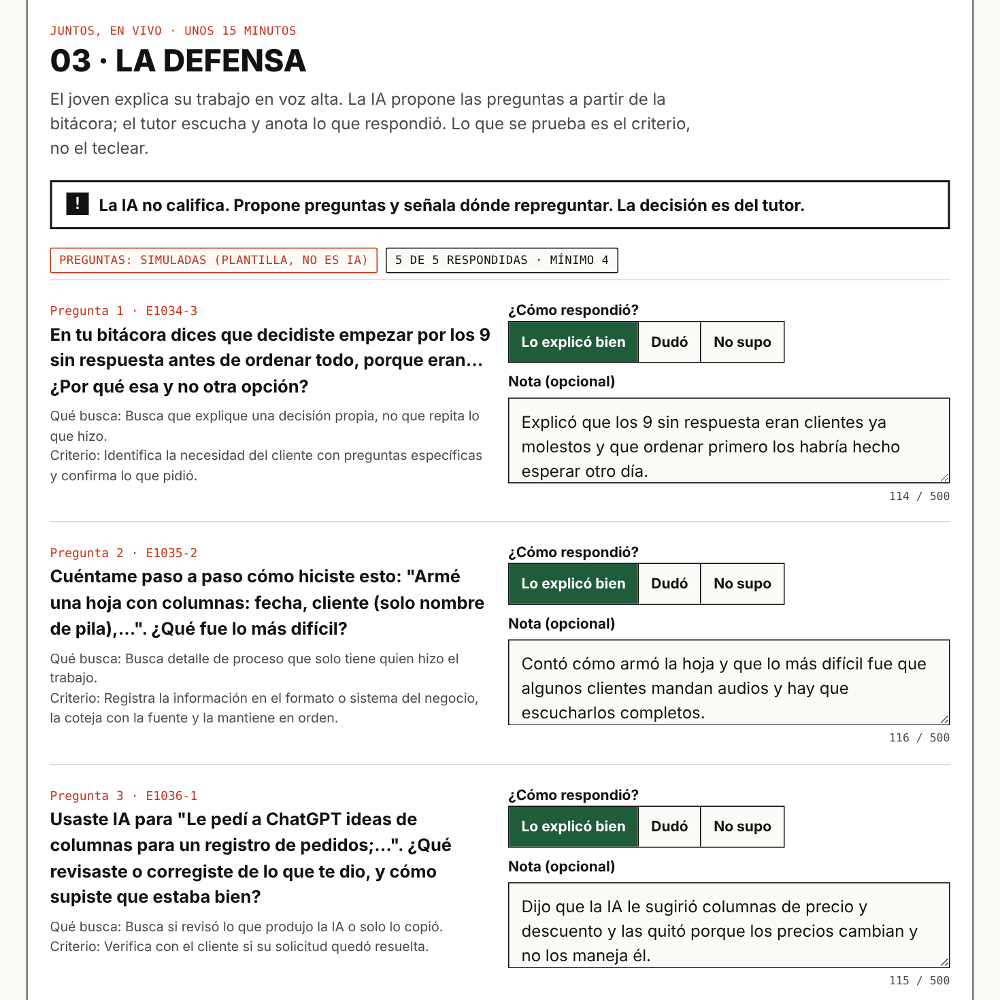
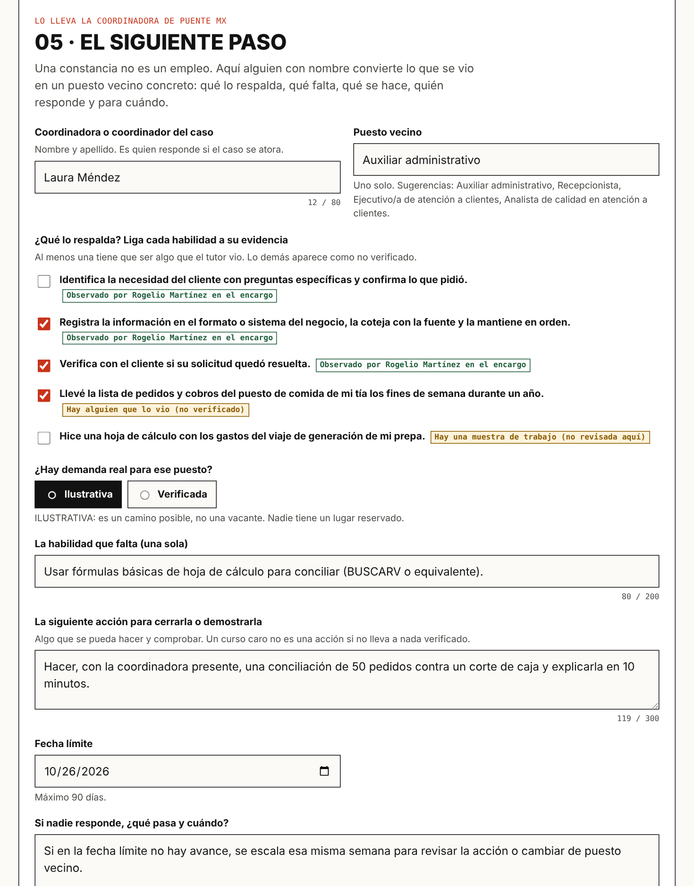
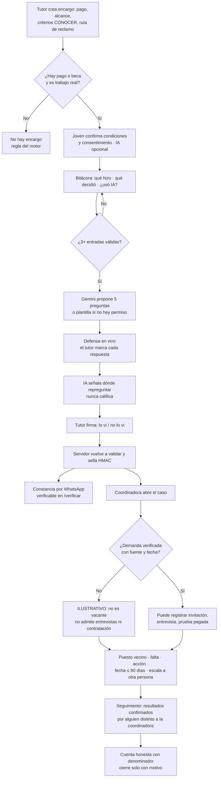
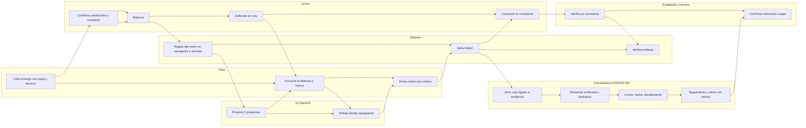

# PACKET — PRUEBA VIVA

**Módulo de primera prueba de PUENTE MX · Semana 9 · AI 2041 Cap. 8 "The Job Savior" · Ship individual · Nicolás Flores**
**En vivo:** https://prueba-viva.vercel.app · **Código:** https://github.com/nicofloresbuilder-code/prueba-viva
**Vacío:** primera prueba · **Rol en Brain Bending:** Technologist · **Equipo:** Miguel Bravo (User), Nicolás Flores (Technologist), Regina (Operator), Cristina Meouchi (Adversary)

---

## 1. El problema, en mis palabras

Un joven de 20 años sin historial no tiene cómo demostrar que sabe hacer un trabajo. Antes eso lo resolvía el primer empleo, pero la IA se está comiendo justo esos puestos: apoyo administrativo, recepción, atención a clientes y captura de datos. Y lo que quedaba para demostrar capacidad sin empleo (un portafolio, una tarea para llevar a casa, un examen en línea) ya no prueba nada, porque un modelo lo hace en minutos. En mi brief lo probé con una conciliación de 120 facturas con 10 diferencias escondidas: un modelo la resolvió sin errores en menos de un minuto.

El Blueprint del equipo agrega la otra mitad: **una constancia sola no es una transición.** Aunque la habilidad quede probada, el paso a una oportunidad real se cae si nadie con nombre lo lleva.

**El problema no es que falte trabajo de entrada. Es que el trabajo que sí ocurre no deja una prueba que viaje, y la prueba no se convierte en un siguiente paso.**

## 2. El usuario exacto

El primer usuario es el que define el Blueprint, sección 4: **una persona ficticia de la CDMX, al inicio de su carrera, que busca un puesto administrativo o de negocios.** Para nuestra demostración es Dany, 20 años: terminó la prepa, no tiene historial formal y ha llevado cuentas de manera informal. Usa el celular para todo y necesita algo que pueda mandar por WhatsApp.

Alrededor de Dany hay tres actores con pantalla propia:

- **El tutor**: Don Rogelio, 52, encargado de una ferretería. Supervisa el encargo pagado, escucha la defensa y firma solo lo que vio.
- **La coordinadora de PUENTE MX** (el rol de operadora de Regina): convierte la constancia en un siguiente paso y le da seguimiento.
- **Quien verifica**: la empresa que recibe el enlace.

El segundo segmento del Blueprint, una persona desplazada de un call center, se atiende con el estándar EC0254. Es la siguiente prueba operativa; este corte no la demuestra.

## 3. Definición de éxito

Antes de que cierre el módulo, todo esto funciona en la URL en vivo:

1. El tutor crea un encargo real y declara **antes de empezar** el pago, el alcance, los criterios de CONOCER con que se revisa y la ruta de reclamo. Un trabajo sin pago se rechaza.
2. El joven confirma que vio esas condiciones y da su consentimiento: la IA es opcional. Puede declarar experiencia informal, que aparece como no verificada.
3. El joven registra en la bitácora qué hizo y qué decidió, y si usó IA y para qué.
4. Un LLM real (Gemini) propone cinco preguntas para la defensa en vivo y luego le señala al tutor dónde repreguntar. **Nunca califica.**
5. El tutor firma criterio por criterio, "lo vi" o "no lo vi". El servidor sella la constancia con HMAC y cualquiera puede verificarla.
6. La coordinadora abre un caso: un puesto vecino ligado a la evidencia, la demanda verificada con fuente o marcada **ilustrativa**, una habilidad que falta, una acción, una fecha límite, a quién se escala y un seguimiento con resultados confirmados por un tercero.
7. La "cuenta honesta" muestra siempre el denominador y nunca cuenta la constancia como empleo.

## 4. Mockup

*Pantalla de defensa: a la izquierda, las preguntas que propone la IA; a la derecha, la respuesta que marca el tutor (un toque y una nota opcional). Arriba queda fija la advertencia de que la IA no califica.*

*Paso 5: la coordinadora liga el puesto vecino a la evidencia. Lo que vio el tutor aparece en verde y lo autodeclarado en ámbar. La demanda va marcada como ILUSTRATIVA.*

## 5. El flujo

Los diagramas también están en imagen: [flujo](img/diagrama1.png) · [quién hace qué](img/diagrama2.png).

### Flujo del producto

### Quién hace qué

## 6. Condiciones del Blueprint y cómo las cumple la app

| Blueprint | Cómo se cumple | Dónde |
|---|---|---|
| §5.1 Intake de la oportunidad: tarea real, alcance, pago/financiamiento, supervisor, rúbrica, si hay ruta real | Campos obligatorios en el encargo; criterios CONOCER como rúbrica; pregunta "¿hay un puesto real?" | `validarEncargo` |
| §5.2 Intake del participante con experiencia informal, fuente y consentimiento | Consentimiento obligatorio, IA opcional; tareas previas con fuente, marcadas "no verificado" | `validarParticipante` |
| §5.3 Micro-experiencia con decisiones e IA declarada | Bitácora con decisión obligatoria; si usó IA, para qué | `validarEntrada` |
| §5.4 Firma solo de lo observado | "Lo vi / no lo vi" por criterio; lo no visto sale en la constancia; nombre igual al del tutor | `validarFirma` |
| §5.5 Handoff del operador: un puesto vecino, una habilidad faltante, una acción, un responsable, una fecha | Paso 5 con todos los campos obligatorios y plazo ≤ 90 días | `validarPuente` |
| §5.6 Revisión de demanda; lo ilustrativo se etiqueta | "Verificada" exige fuente y fecha; "ILUSTRATIVO · no es una vacante" en pantalla | `DEMANDA` |
| §5.7 Seguimiento con evidencia; perfil ≠ colocación | Resultados con fecha, evidencia y quién confirma; éxito solo si hay prueba pagada o contratación | `validarResultado`, `transicionConfirmada` |
| §7 Habilidad ligada a evidencia; incierto se ve incierto | Al menos una evidencia observada por el tutor; lo autodeclarado en ámbar | `evidenciasDisponibles` |
| §7 Coordinador, acción, fecha y escalamiento | Escalamiento a otra persona con nombre | `validarPuente` |
| §7 Consentimiento controla la evidencia; datos mínimos | Nada en servidor; bitácora no viaja; filtro de teléfonos, correos, CURP, contraseñas | `revisarTexto`, `sello.ts` |
| §9 Mano de obra barata | Sin pago no hay encargo; "gratis" o "a prueba" se rechaza; condiciones vistas por el joven antes de empezar | `validarEncargo` |
| §9 Prueba falsa | La IA no aprueba nada; el motor descarta puntajes; la firma dice lo observado, no garantiza desempeño | `respuestaTraeCalificacion`, `NO_PRUEBA` |
| §9 Falsa esperanza | Con demanda ilustrativa no se pueden registrar entrevistas ni contratación; no hay porcentajes de match | `validarResultado` |
| §10 Denominador y fuente | Cuenta honesta: "x de 1 caso", sin porcentajes | `cuentaHonesta` |
| §11 Technologist: la IA no aprueba; revisión humana y rastro de decisiones | Firma humana obligatoria; bitácora con decisiones; el servidor vuelve a validar todo | `api/sellar` |
| §11 Operator: el caso solo avanza con evidencia, responsable, destino, falta, acción y estado | `validarPuente` + `puedeCambiarEstado` + `puedeCerrar` | paso 5 |
| §11 Adversary: lo demo se etiqueta; nada inventado | "EJEMPLO inventado", "SIMULADO", "ILUSTRATIVO" en pantalla | interfaz |

**Cláusula de sombra del capítulo:** lo que parece trabajo sin serlo. Las prácticas, los trabajos sin pago y las tareas inventadas no generan constancia, y una constancia nunca cuenta como empleo.

## 7. Benchmark

- **La mejor solución que existe en el mundo** es el sistema dual alemán: un tercero (la cámara IHK) examina trabajo real hecho en una empresa. En 2024, 246,328 aprendices presentaron examen final.
- **La mía se diferencia** en que no necesita cámara ni convenio. El tercero es el supervisor del encargo pagado. La prueba es una defensa en vivo del trabajo propio, que la IA no puede hacer por ti. La constancia viaja por WhatsApp con verificación criptográfica. Y una coordinadora la convierte en un siguiente paso con demanda verificada o etiquetada.

## 8. Visión a 3 años

Si esta rebanada funciona, PUENTE MX se vuelve la capa de evidencia y transición de los programas que ya colocan a jóvenes en centros de trabajo: JCF, la formación dual y el servicio social. Cada encargo terminaría en una constancia verificable y en un caso con resultado confirmado. El peso de cada firma dejaría de ser declarado y se anclaría en historial: los tutores cuyas constancias resultaron ciertas valdrían más. Las constancias se emitirían como credenciales W3C VC 2.0 y los casos vivirían en una base con autenticación, para que Cristina pueda auditar resultados reales con denominador.

## 9. Lo que NO construyo

- No es una bolsa de trabajo: no hay vacantes, ni postulaciones, ni búsqueda de candidatos. El puesto vecino es una dirección, no una vacante.
- No es un generador de CV.
- No hay calificación numérica, ni porcentaje de match, ni ranking de personas.
- No hay cuentas ni base de datos. Los casos viven en el dispositivo y se pueden descargar.
- No hay pagos reales, ni verificación de identidad, de RFC o de JCF, ni conexión con empleadores. Eso es del piloto (Blueprint §6 y §12).
- No incluye la alerta temprana de desplazamiento de Cristina. Según el Blueprint, es una extensión posterior.
- No hay vista propia del joven para seguir su caso. Va en la siguiente iteración.

## 10. Arquitectura y stack

| Capa | Qué | Por qué |
|---|---|---|
| Interfaz | Next.js 16 (App Router), React 19, TypeScript | Despliega gratis en Vercel. |
| LLM | Google Gemini (capa gratuita), llamado solo desde rutas del servidor | La llave vive en Vercel. Sin llave, o sin permiso del joven, se usa una plantilla **etiquetada en pantalla**. |
| Datos estructurados y verificados | Estándares de Competencia CONOCER publicados en el DOF: EC0305 y EC0254 | Criterios oficiales y públicos; ni yo ni el modelo los inventamos. |
| Tercera pieza | Sello HMAC-SHA256 y página de verificación, más las reglas del puente del operador | Prueban origen e integridad, y que el caso no avanza sin evidencia. |
| Estado | localStorage del navegador, con exportación del caso en JSON | Sin cuentas ni base de datos, nada personal llega al servidor, así que no hace falta auth. |
| Validación | `src/lib/motor.ts`, aplicado en el navegador y otra vez en el servidor | Las salvaguardas no se saltan desde otra pantalla. |

**Piso de seguridad:** no hay secretos en el repo (`GEMINI_API_KEY` y `FIRMA_SECRETA` viven solo en Vercel) ni datos personales guardados en el servidor. Cada formulario tiene límites y filtro de secretos y datos de contacto. Hay un límite de solicitudes por IP. Los datos del demo son inventados y están etiquetados.

## 11. Plan de pruebas

| # | Prueba | Esperado |
|---|---|---|
| 1 | Encargo marcado como "práctica" | Se rechaza y se explica. |
| 2 | Pago "gratis, a cambio de experiencia" | Se rechaza: sin pago no hay encargo. |
| 3 | Encargo sin alcance, sin ruta de reclamo o sin confirmar que se mostró | Se rechaza. |
| 4 | Bitácora sin consentimiento o sin que el joven confirme las condiciones | La bitácora no se abre. |
| 5 | "Usé IA" sin decir para qué | No se guarda. |
| 6 | Contraseña, CURP, teléfono o correo en cualquier campo | Se rechaza antes de guardar. |
| 7 | Preguntas sin llave o sin permiso del joven | Plantilla marcada en pantalla. |
| 8 | Preguntas con llave de Gemini | 5 preguntas ligadas a criterios, marcadas "Gemini". |
| 9 | Respuesta del LLM con calificación | Se descarta. |
| 10 | Firmar con otro nombre o sin defensa | Se rechaza. |
| 11 | Alterar una letra del enlace | La verificación dice que no es auténtica. |
| 12 | Caso solo con evidencia autodeclarada | Se rechaza. |
| 13 | Demanda "verificada" sin fuente ni fecha | Se rechaza. |
| 14 | Entrevista registrada con demanda ilustrativa | Se rechaza. |
| 15 | La coordinadora confirma su propia entrevista | Se rechaza. |
| 16 | Cerrar sin resultado, sin motivo, o "como transición" sin confirmarla | Se rechaza. |
| 17 | Cuenta honesta | Siempre "x de 1 caso", sin porcentajes. |
| 18 | Celular a 390 px | Sin scroll horizontal. |

## 12. Resultado de las pruebas

**Autoprueba del motor:** `npx tsx src/lib/__selftest.ts` da 91 aserciones correctas y 0 fallas.

**Pase mecánico (Playwright contra el build de producción):** pasan las pruebas 1 a 7 y 9 a 18. La 8 (con llave real de Gemini) se corre en el despliegue.

**Bugs encontrados y corregidos:**

- La pregunta simulada repetía "decidiste \"Decidí…\"".
- La bitácora se abría aunque el joven no hubiera confirmado las condiciones.
- Las horas de la bitácora de ejemplo salían de madrugada por la zona horaria.
- Se apagó el "pensamiento" de Gemini 2.5 Flash para que no trunque el JSON.

**Persona test:** dos rondas con cinco personas, 37 confusiones registradas y 23 cambios. Ver `docs/PERSONA.md`.
