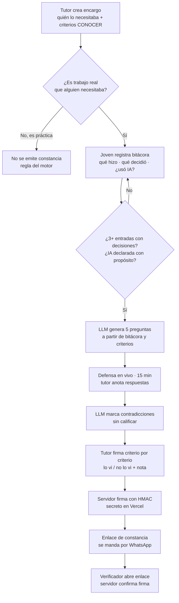
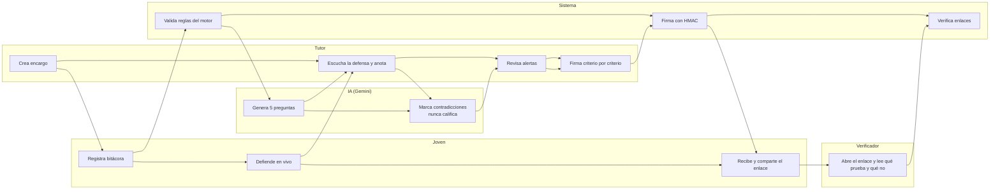

# PACKET — PRUEBA VIVA

**Semana 9 · AI 2041 Cap. 8 "The Job Savior" · Ship individual · Nicolás Flores**
**Vacío:** primera prueba · **Rol en Brain Bending:** Technologist

---

## 1. El problema, en mis palabras

Un joven de 20 años sin historial no tiene cómo demostrar que sabe hacer un trabajo. Antes lo resolvía el primer empleo, pero la IA se está comiendo justo esos puestos (apoyo administrativo, recepción, atención a clientes, captura de datos). Y lo que quedaba para demostrar capacidad sin empleo —un portafolio, una tarea para llevar a casa, un examen en línea— ya no prueba nada, porque un modelo los hace en minutos. En mi brief lo probé: una conciliación de 120 facturas con 10 diferencias escondidas, resuelta sin errores en menos de un minuto.

Mientras tanto, Jóvenes Construyendo el Futuro coloca a medio millón de jóvenes al año en centros de trabajo con un tutor, y al terminar se van con la beca y sin nada que demuestre lo que aprendieron.

**El problema no es que falte trabajo de entrada; es que el trabajo que sí ocurre no deja una prueba que viaje.**

## 2. El usuario exacto

Dos personas usan la misma pantalla, en el mismo lugar, en el mismo momento:

- **El tutor**: Don Rogelio, 52, encargado de una ferretería en Iztapalapa que recibe aprendices de JCF. Usa WhatsApp todo el día, no tiene computadora en el mostrador, y no va a llenar formularios largos. Firma si entiende qué está firmando.
- **El joven**: Dany, 19, aprendiz en esa ferretería, terminó la prepa, quiere entrar a un call center o a recepción. Usa el celular para todo. Lo que necesita es algo que pueda mandar por WhatsApp a quien lo vaya a contratar.

Un tercer actor solo lee: **quien verifica** (una empresa que recibe el enlace de la constancia).

## 3. Definición de éxito

Antes de que cierre el módulo, esto funciona en la URL en vivo:

1. El tutor crea un encargo real ligado a criterios de un Estándar de Competencia oficial de CONOCER.
2. El joven registra en su bitácora cómo hizo el trabajo, incluido si usó IA y para qué.
3. Un LLM real lee el encargo y la bitácora y genera cinco preguntas para la defensa en vivo; después marca contradicciones para el tutor. **Nunca califica.**
4. El tutor firma criterio por criterio (lo vi / no lo vi), y el servidor firma la constancia con una llave secreta.
5. Cualquiera con el enlace puede verificar que la constancia es auténtica y no fue alterada, y ve qué prueba y qué **no** prueba.

## 4. Mockup

*Mockup generado de la pantalla de defensa: las preguntas de la IA a la izquierda, las notas del tutor a la derecha, y la advertencia permanente de que la IA no califica.*

## 5. El flujo

### Flujo del producto

### Quién hace qué

## 6. Benchmark

- **La mejor solución existente en el mundo** es el sistema dual alemán: un tercero (la cámara IHK) examina trabajo real hecho en empresa; 246,328 aprendices presentaron examen final en 2024.
- **La mía se diferencia** en que no necesita cámara ni convenio: el tercero es el tutor que ya existe en JCF, la prueba es una defensa en vivo del trabajo propio (resistente a la IA), y la constancia viaja por WhatsApp con verificación criptográfica.

## 7. Visión a 3 años

Si esta rebanada funciona, PRUEBA VIVA se vuelve la capa de evidencia de los programas que ya colocan jóvenes en centros de trabajo —JCF, la formación dual, los servicios sociales universitarios— y cada año de programa termina en constancias que una empresa puede verificar en segundos. El peso de cada firma deja de ser declarado y se ancla en historial: tutores con constancias que luego resultaron ciertas valen más. Y la constancia se emite como credencial verificable estándar (W3C VC 2.0), para que no dependa de esta app.

## 8. Lo que NO construyo

- No es bolsa de trabajo: no hay vacantes, no hay postulaciones, no hay búsqueda de candidatos.
- No es generador de CV: no se redacta nada por el joven.
- No hay calificación numérica ni ranking de personas, ni de la IA ni de nadie.
- No hay cuentas ni base de datos: nada personal vive en el servidor.
- No verifico el RFC ni la inscripción a JCF: el tipo de centro es **declarado** y así se muestra.
- No hay video ni grabación de la defensa.

## 9. Arquitectura y stack

| Capa | Qué | Por qué |
|---|---|---|
| Interfaz | Next.js 16 (App Router), React 19, TypeScript | El mismo stack de semanas anteriores; despliega gratis en Vercel. |
| LLM | Google Gemini (capa gratuita), llamado solo desde rutas del servidor | La llave vive en una variable de entorno de Vercel, nunca en el navegador ni en el repo. Si falta la llave o falla, la app usa un generador simulado **etiquetado en pantalla**. |
| Datos estructurados y verificados | Estándares de Competencia de CONOCER publicados en el DOF: EC0305 y EC0254 | Criterios oficiales y públicos, no inventados por mí ni por el modelo. |
| Tercera pieza | Firma HMAC-SHA256 en el servidor + página de verificación | Prueba que la constancia salió de esta app y que nadie la editó. |
| Estado | localStorage del navegador | Sin cuentas ni base de datos → nada personal en el servidor → no hace falta auth. |
| Validación | Reglas del motor en `src/lib/motor.ts`, aplicadas también en cada ruta del servidor | Las salvaguardas no se pueden saltar desde otra pantalla. |

**Piso de seguridad:** sin secretos en el repo (`GEMINI_API_KEY` y `FIRMA_SECRETA` solo en Vercel); sin datos personales guardados en servidor; cada formulario con límites de longitud y filtro de secretos (contraseñas, CURP, RFC de persona, tarjetas, teléfonos, correos); demo con datos inventados y etiquetados.

## 10. Plan de pruebas

| # | Prueba | Esperado |
|---|---|---|
| 1 | Encargo marcado como "práctica" | El motor rechaza emitir constancia y lo explica. |
| 2 | Bitácora con 2 entradas | No deja pasar a la defensa. |
| 3 | Entrada con "usé IA" sin decir para qué | No se guarda. |
| 4 | Escribir una contraseña o CURP en la bitácora | El campo la rechaza antes de guardarla. |
| 5 | Generar preguntas sin `GEMINI_API_KEY` | Aparecen preguntas marcadas como SIMULADO. |
| 6 | Generar preguntas con llave | 5 preguntas, cada una ligada a un criterio, marcadas como Gemini. |
| 7 | Respuesta del LLM con una "calificación" | Se descarta; la interfaz nunca muestra puntaje. |
| 8 | Firmar con nombre de pila solo | Rechazado: nombre y apellido. |
| 9 | Firmar sin haber hecho la defensa | Rechazado. |
| 10 | Editar una letra del enlace de la constancia | La verificación dice que no es auténtica. |
| 11 | Abrir el enlace en otro dispositivo | Se ve la constancia con lo que prueba y lo que no. |
| 12 | Vista en celular (390 px) | Todo se usa sin scroll horizontal. |
